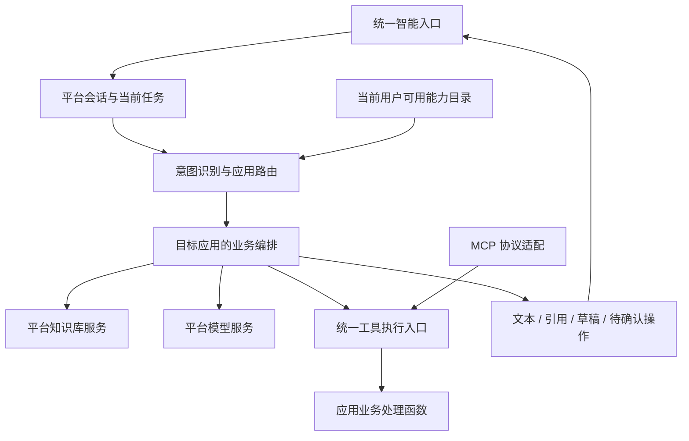

# 统一智能入口与平台知识能力方案

日期：2026-10-27。当前平台1.7.1。按用户确认的首版范围，P1知识平台化、P2a统一入口与应用编排、P2b只读工具/MCP、P3逐条语料RAG已实现；本地向量模型已接通。见[知识验收](acceptance-knowledge-p1.md)、[统一对话验收](acceptance-chat-p2a.md)、[工具验收](acceptance-tools-p2b.md)、[P3验收](acceptance-knowledge-p3.md)及[本地模型试跑](acceptance-local-embedding.md)。

2026-10-28已接通DeepSeek，真实意图分流、连续追问、计划生成、知识引用、只读MCP调用及运行中取消已完成独立环境验收，见[DeepSeek验收](acceptance-deepseek.md)。当前待收尾：收紧计划生成时偏多的补充问题；扩大真实语料检索评估；正式服务器部署时补齐模型服务进程托管与重启恢复验收。当前仅在独立本地环境联调，尚未提交、推送或生产部署。

确认写入、模型自主工具循环、文档上传解析、第三方远程/对外MCP是后续扩展，不是已确认首版的遗漏。下文保留总体设计；涉及这些能力的描述不表示当前已经实现。

## 目标与范围

员工通过一个智能入口发起任务。平台识别意图，选择有权限的应用能力；应用用自己的编排处理业务，调用平台知识库和应用工具，通过同一会话回复。

平台提供知识库、模型调用、会话、路由、运行记录和工具接入。应用拥有自己的知识内容、业务编排、提示词及 MCP 工具实现。各应用无需另建聊天入口，原有业务页面继续使用。

本次按顺序交付三个阶段：慧策通知识能力平台化；统一入口与应用编排、只读 MCP 工具；逐条语料 RAG。按用户后续确认，文档上传解析与确认写入后置。

## 现有基础

- [AI 网关](../server/src/app-platform/gateway/ai.ts)提供 `platform.ai.complete`，当前仅支持单次文本生成。
- [模型适配器](../server/src/core/integrations/ai/index.ts)支持工具声明和 `tool_calls` 消息，但尚未形成面向应用的工具执行循环。
- [应用清单](../packages/platform-sdk/src/manifest.ts)已有 API、权限和平台能力声明，可以增量扩展。
- [应用后端 SDK](../packages/platform-sdk/src/server.ts)已有 `defineServer`、员工上下文、权限检查、平台调用和取消信号。
- [平台 Gateway](../server/src/app-platform/gateway/gateway.ts)已有鉴权、限流、超时和审计。新功能沿用这些机制，不顺带重写已有鉴权实现。
- [慧策通业务代码](../applications/huicetong/src/reform-service.mjs)已有专有名词、标准示例、基础相似匹配、计划整理与结果校验，可作为首个接入案例。

## 总体结构

统一入口是一处员工界面；内部模块按职责组织，不要求拆成多个服务。继续采用 `.mopkg`、受管子进程和现有数据库、存储。

### 平台与应用的责任

| 能力 | 平台负责 | 应用负责 |
| --- | --- | --- |
| 意图路由 | 按权限构建目录、选择目标、澄清歧义、维护当前任务 | 描述能力用途、典型请求及编排入口 |
| 知识库 | 内容存取、索引检索、引用、应用和组织隔离 | 内容、管理界面、知识用途、业务范围 |
| 编排 | 调用生命周期、运行记录、模型与工具 SDK、取消和时间上限 | 普通代码实现业务步骤和规则 |
| 工具 / MCP | 注册、协议适配、身份绑定、调用与审计 | 工具描述、输入契约、业务处理与资源授权 |
| 业务写入 | 确认操作入口、携带身份和请求标识 | 业务状态校验、事务和幂等写入 |

## 一、知识能力平台化

### 第一阶段的数据与接口

先支持结构化文本知识。最少包含知识库与知识条目：知识库绑定应用安装实例，条目保存正文、类型、组织范围、来源标识、版本和必要元数据。

应用标识从平台调用上下文取得，不能由模型或前端参数决定。应用可以有多个知识库，默认只访问自己名下的库；本期不做跨应用共享库授权体系。

P1知识库通过 `app.json.knowledgeBases` 声明并随安装生效，SDK 提供 `list/search/write` 三个接口，不另设建库接口。检索返回条目 ID、命中内容、来源、版本及排序信息，不代替应用生成业务结论。

专有名词采用精确匹配；标准示例先沿用已有基础相似排序。平台保留通用条目类型和元数据，计划字段及“必须原样保留名词”等规则留在慧策通。低相关或无命中时返回空结果，不强行补足条数。

### 权限

条目的知识使用权限和知识维护权限分别处理。慧策通现有行为中，计划提报者可以使用参考语料，但不因此获得语料维护权限，迁移后保留这一行为。

平台根据已安装声明中的权限绑定和可信员工上下文执行范围过滤；调用方不能传一个任意权限码扩大范围。检索结果在进入模型上下文之前完成过滤。引用回看也通过知识访问入口。

### 慧策通切换（已确认）

用户在2026-10-27确认“尚无有效语料，可直接改接平台知识库”。P1因此直接切换语料维护和 `plan-suggest`，不开发导入、双写或迁移恢复机制，也不删除历史迁移和旧表。有有效旧语料的其他环境需另行规划迁移。

## 二、统一入口与意图识别

### 应用能力声明

在现有 `app.json` 增加可选智能能力声明，与 API 一样随安装和升级生效。每项只包含：稳定 ID、名称、用途描述、少量典型表达、所需业务权限和编排 handler 引用。

工具声明包含：稳定 ID、描述、输入 schema、处理入口、所需权限和读写类型。工具、编排与现有 handler 的对应关系在包检查和安装边界验证。未声明的普通业务 API 不自动变为工具。

声明以安装包为事实来源，从当前已启用版本生成运行目录，不另建可手工维护的重复注册中心。应用停用或升级后，新调用使用当前有效目录。

### 路由策略

1. 平台校验用户请求、解析员工身份并读取会话当前任务。
2. 正在补充参数或确认操作时继续当前任务；用户明显改变目标时重新识别。
3. 向模型提供当前用户可使用的应用能力描述，请其返回“目标能力、需要澄清、无匹配”之一。
4. 在模型输出边界验证结构及目标是否属于提供的目录，再调用目标编排。
5. 缺参数由目标应用编排追问；多个能力存在歧义时由入口澄清。

首版每轮只交给一个业务编排。复合请求明确拆分并逐项处理，暂不加入跨应用自动并行、任务图规划或多智能体协商。路由不靠模型自报置信分数设置复杂阈值，也不加载全平台工具和知识正文。

### 会话与结果

统一界面支持历史消息、处理中状态、取消、引用、业务页面链接和待确认操作。复用共享组件、平台主题和现有员工身份。

平台保存会话消息、当前任务、运行状态及必要步骤事件；应用只收到完成当前任务需要的消息和参数，不把其他应用的整段业务结果默认传给新目标。

结果先采用少量固定类型：普通回复、需要补充信息、业务草稿、待确认操作。业务草稿可打开应用页面继续填写，避免首版把所有复杂表单搬进聊天框。

不强制最后再调用一次模型润色；目标编排的最终结果可以直接展示。

## 三、应用编排与工具 / MCP

### 编排用普通代码

应用用异步函数编写“检索知识 → 查询业务 → 调用模型 → 整理结果”等步骤。平台 SDK 提供知识检索、模型调用、工具调用和运行事件，不建立通用节点 DSL、可视化编辑器或工作流解释器。

确定的业务步骤直接编写；确实需要模型选择工具时，才使用一个有步数与总时限限制的执行循环。编排运行设独立总时限，内部单次平台调用继续遵守已有 Gateway 时限；不直接放大全平台超时。

慧策通首个编排：收集月份和原话 → 检索名词与示例 → 生成计划草稿 → 校验业务字段 → 返回草稿或追问。复用现有计划整理逻辑。

### 一份工具定义，两种调用方式

应用实现一份工具描述和 handler。平台内部编排直接调统一工具执行入口；MCP 适配器将同一份定义映射为标准工具列表和调用协议，最终执行同一个 handler。

MCP 接入复用受管应用运行时，不要求每个应用另开服务端口、独立进程或重复实现业务。真正的协议适配需要协议级验证，不能把普通 JSON 调用命名为 MCP 就当作完成。

本期 MCP 范围为平台与受管应用之间的工具接入。向外部客户端公开平台 MCP、接入任意第三方 MCP 服务及其凭据管理另定范围。内部直调保留同样的身份和权限约束。

### 写入确认

先交付只读工具和草稿，再开放确认写入。确认记录绑定用户、目标应用、工具、具体参数和请求标识；用户修改参数后需要形成新的确认内容。

确认是一个新的请求入口，此时检查当前用户权限、应用状态和业务记录状态。平台只允许执行确认绑定的操作，模型的文字不能作为确认凭证。应用内写入复用现有事务和幂等机制，外部写入失败不自动重放。

取消终止尚未执行的步骤并传递取消信号；已经提交的业务写入显示实际结果，不声称已回滚。首版进程中断后将未完成运行标记为中断，不自动恢复或重放业务步骤。

## 四、通用文档 RAG（后置扩展）

结构化知识和统一入口运行稳定后补齐：

- 文档上传、处理状态、解析分段、分段预览。
- embedding 模型配置、语义检索与关键词检索组合。
- 文件名、页码或段落定位、版本引用。
- 文档更新生成新索引，完成后切换；删除或停用的文档立即停止参与检索。
- 一组真实业务问题的召回与引用验收。

首批文档格式建议支持 TXT、Markdown、DOCX 和可提取文本的 PDF；扫描 PDF/OCR、复杂表格还原另行确定，不默认引入。

索引记录文档版本及向量模型信息，避免不同模型结果混用。文档处理采用数据库任务状态和单个后台处理器即可，不提前引入独立消息队列。

实施前根据文档规模、现有数据库扩展支持和模型服务能力选择向量存储方案，并明确部署影响。此时再决定是否增加数据库扩展或外部服务，本方案不预设新的基础设施。

## 五、工程约束

以下规则适用于本次新增和修改代码，不扩展为全仓库重构：

1. 每份外部输入在所属入口完成一次结构校验和必要归一化；内部函数接收确定类型，直接使用，不重复判空、重复 parse 或逐层兜底。
2. HTTP 请求、模型生成的工具参数、MCP 调用分别是独立输入。指定单一校验责任方，共用 schema；协议包装只校验协议字段，不再重复校验已通过工具入口验证的业务参数。
3. 结构校验与授权分工明确：应用准入由宿主负责，知识范围由知识服务负责，业务资源归属与状态由业务 handler 负责；不在每层复制相同规则。确认提交是新请求，按当前状态授权。
4. `try/catch` 仅用于外部边界错误转换、明确可恢复分支或事务处理；其他异常交给现有统一错误处理。不捕获后返回空数组、假成功或掩盖失败原因。资源释放用 `finally`。
5. 只用一次的顺序逻辑放在原处。出现真实复用、独立业务职责或难以理解的长流程时再抽函数，不预建通用适配器层和可插拔框架。
6. 不为低概率假设提前加入备用存储、多级缓存、自动重放、复杂熔断、分布式锁或修复状态机。若出现实际证据，先说明发生条件、影响和最小方案，征求用户同意后再做。
7. 权限、事务、幂等、输入大小与取消等已有契约继续沿用，不把删除有效检查作为简化手段；也不重复包装现有机制。
8. 测试验证行为与边界，避免镜像实现和无意义覆盖率堆叠。

## 六、实施阶段与验收

| 阶段 | 交付 | 验收门槛 |
| --- | --- | --- |
| P1 知识平台化 | 平台文本知识服务、权限绑定、SDK；慧策通语料维护和计划整理接入 | 迁移内容一致；应用/组织范围正确；使用与维护权限分离；名词保护和计划草稿行为保持；无匹配不硬塞案例 |
| P2a 统一入口与编排 | 应用能力声明、路由、会话、运行记录、SDK 编排入口；慧策通首个编排 | 自然语言进入正确编排；补充参数继续原任务；歧义可澄清；无权限能力不可调用；取消和失败状态明确 |
| P2b 工具与 MCP | 单一工具目录与执行入口、MCP 协议适配、只读工具；确认写入后置 | 内部和 MCP 调用的授权结果一致；未声明工具不可调用；参数只在约定边界校验；只读工具拒绝平台写操作 |
| P3 逐条语料 RAG | 逐条维护、后台向量索引、语义检索、引用及更新删除；文档导入后置 | 条目版本可追溯；应用与组织隔离；失效向量不参与检索；索引状态及失败重建明确 |

P2 已选择待办事项作为第二个只读接入应用，验证路由与契约没有写死慧策通。

每阶段检查相关后端测试、SDK 和前端类型与构建、受影响应用测试及打包。统一入口增加浏览器操作、主题与必要响应式检查。MCP 增加实际客户端的列表与调用验证。涉及新公开接口同步开发文档；正式功能按可交付更新统一升版、补 CHANGELOG 并运行版本检查。

本方案文档不单独升产品版本，也不提交、推送或部署。实施时保留工作区现有修改；本次较大改造使用一个专用分支持续推进，不为各阶段重复建分支。

## 七、实施前需要定案的事项

这些事项不影响本方案成立，但进入对应阶段前需确定：

- P1已确认：无有效旧语料，直接改接平台知识库。
- P2 已确认：首版只读工具，第二个应用为待办事项；写入工具清单与确认内容以后另定。
- P3 已确认：逐条语料优先，不依赖文档上传；现有 PostgreSQL 保存向量。1.7.1已接通本地BGE-small-zh-v1.5，服务器本机和内网HTTP/HTTPS连接通过启动地址白名单支持。

向外公开 MCP、跨应用自动并行、长期记忆、可视化编排和 OCR 留作后续独立需求，当前不预留复杂框架。

## P2a 实施记录（1.5.0）

统一入口位于员工侧栏工作台下方，名称“新建对话”。聊天首页提供应用声明的示例卡片，点击填入输入框；支持历史、连续追问、停止和明确失败状态。首批为慧策通 2.2.0 月度计划草稿及待办事项 1.1.0 状态查询。应用编排继续使用普通函数，平台负责权限目录、单目标意图路由和会话。

P2a 验收时尚未实施工具目录与 MCP；后续 P2b 只读交付见下节，确认写入与 P3 文档 RAG 仍待实施。

## P2b 实施结果（平台 1.6.0）

按用户确认先交付只读工具。app.json 声明工具、参数契约、业务权限及独立处理函数；平台提供员工绑定、目录、直调与 MCP 两种传输。两种传输进入同一宿主处理路径。MCP 使用官方 SDK 内存会话，不新增独立服务或应用监听端口。

待办事项 1.2.0 的编排经 MCP 查询待办，慧策通 2.3.0 经直调工具检索部门知识。工具执行中平台写接口被拒绝。此限制属于平台网关，应用仍是受信任的 Node 子进程，不是操作系统沙箱。

后续确认写入与模型自主选工具另行实施；本轮未接第三方远程 MCP，也未改变统一聊天入口。

## P3 首版（平台 1.7.0 / 慧策通 2.4.0）

按逐条维护语料实施，专有名词保留精确匹配，标准示例增加后台向量索引与语义检索。管理端独立配置向量模型；慧策通显示状态、提供手动重建，并在计划整理及统一对话中展示检索来源 ID 与版本。未配置或索引不完整时明确使用文本检索。

首版使用 PostgreSQL 数组和精确相似度排序，未引入文档解析、外部向量库或额外运行服务。1.7.1已完成本地真实向量模型的小样本试跑，正式业务语料质量验收仍待扩充；实施与验证见 [P3 验收记录](acceptance-knowledge-p3.md)和[本地模型试跑](acceptance-local-embedding.md)。
